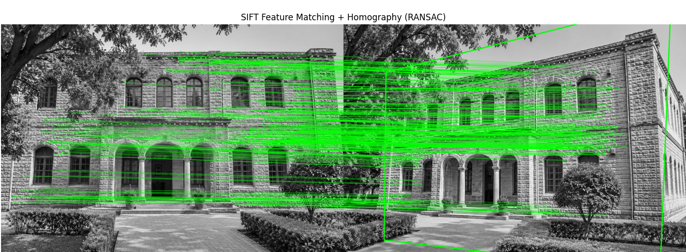
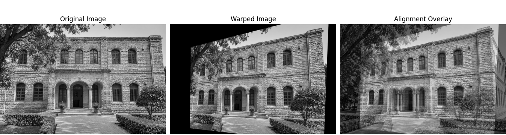
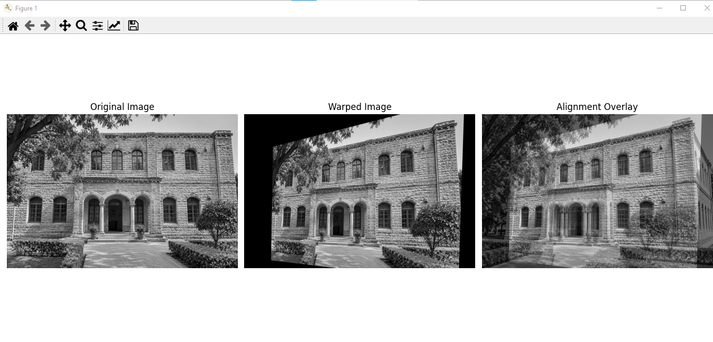
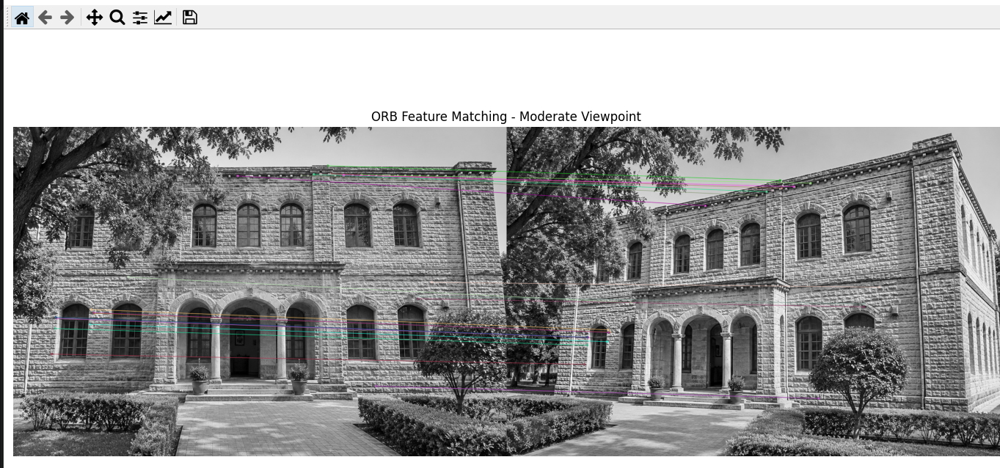

# SIFT vs ORB: Feature Matching and Homography Estimation

A Python/OpenCV computer-vision project that compares **SIFT (Scale-Invariant Feature Transform)** and **ORB (Oriented FAST and Rotated BRIEF)** for local feature detection, descriptor matching, and geometric verification across different image viewpoints.

The project implements feature detection, descriptor matching, Lowe's ratio test, RANSAC-based homography estimation, independent test-set validation, and image alignment visualization.

## Project Overview

The experimental pipeline covers:

1. Feature detection and descriptor extraction.
2. FLANN-based K-nearest-neighbor matching for SIFT.
3. Brute-force Hamming matching for ORB.
4. Lowe's ratio test to reject ambiguous matches.
5. An 80/20 split of matched correspondences into training and testing subsets.
6. RANSAC homography estimation using training correspondences.
7. Independent test-set geometric validation using a **3-pixel reprojection-error threshold**.
8. Perspective warping and image alignment visualization.

## Project Structure

```text
SIFT-ORB-Feature-Matching/
│
├── README.md
├── requirements.txt
├── .gitignore
│
├── data/
│   ├── test1.png
│   └── test2.png
│
├── results/
│   ├── demo1.png
│   ├── demo2.png
│   ├── homo2.png
│   └── homopag.png
│
└── src/
    ├── BFMDemo.py
    ├── FM+Homography.py
    ├── ORB+Homography.py
    ├── SIFTDemo.py
    └── Stitcher.py
```

## Visual Results

The following figures show the feature-matching and image-alignment outputs generated during the experiments.

### 1. SIFT Feature Matching with RANSAC

This visualization shows the feature correspondences identified by SIFT between two images of the same building from different viewpoints. The green lines represent matched feature points after the matching and geometric verification pipeline.



### 2. SIFT Homography and Image Alignment

The visualization presents three stages of the homography process:

- **Original Image:** The reference image.
- **Warped Image:** The second image transformed using the estimated homography.
- **Alignment Overlay:** Both images blended together to inspect their geometric alignment.



### 3. Additional Homography Visualization

This figure provides another view of the perspective transformation and alignment output, showing the original image, warped image, and blended overlay.



### 4. ORB Feature Matching — Moderate Viewpoint

This visualization shows ORB feature correspondences between the two building images under a moderate viewpoint change. It demonstrates the matching output produced using ORB descriptors and Brute-Force Hamming matching.



## Experimental Results

The following values are from the experimental report.

### SIFT Results

Three image-pair scenarios were evaluated: original, extreme, and moderate viewpoint changes.

| Metric | Original Viewpoint | Extreme Viewpoint | Moderate Viewpoint |
|---|---:|---:|---:|
| Good matches | 7,676 | 14 | 573 |
| Training inliers | 2,945 | 4 | 232 |
| Training inlier ratio | 48.0% | 33.3% | 50.5% |
| Testing matches | 1,535 | 2 | 114 |
| Testing inliers | 705 | 0 | 46 |
| Testing inlier ratio | 45.9% | 0.0% | 40.4% |
| Validated test mean error | 1.098 px | N/A | 1.262 px |

**Observation:** SIFT performed well on the original and moderate viewpoint pairs. Its performance deteriorated substantially under the extreme viewpoint change. The extreme-viewpoint pair produced too few correspondences for meaningful independent test validation.

### ORB Results

ORB was evaluated on the moderate-viewpoint pair using two feature limits.

| Metric | ORB (8,000 Features) | ORB (20,000 Features) |
|---|---:|---:|
| Keypoints per image (configured limit) | 8,000 | 20,000 |
| Good matches | 80 | 177 |
| Training inliers | 20 | 44 |
| Training inlier ratio | 31.2% | 31.2% |
| Testing matches | 16 | 36 |
| Testing inliers | 4 | 10 |
| Testing inlier ratio | 25.0% | 27.8% |
| Validated test mean error | 1.738 px | 1.269 px |
| Validated test median error | 1.563 px | 1.074 px |

**Observation:** Increasing ORB's feature limit increased the number of matches and validated test inliers. ORB's matching performance remained below SIFT in the reported moderate-viewpoint experiment.

### Overall Comparison

| Criterion | SIFT | ORB |
|---|---|---|
| Descriptor | Floating-point | Binary |
| Matcher used | FLANN | Brute-force Hamming |
| Correspondences in reported tests | Higher | Lower |
| Matching results in tested pair | Better | Lower |
| Typical computational profile | Generally slower | Generally faster |

**Timing note:** Runtime was not benchmarked. The speed comparison describes general algorithmic characteristics, not a measured result from this project.

## Methodology

### 1. Feature Detection and Description

- SIFT detects scale- and rotation-invariant keypoints and generates floating-point descriptors.
- ORB detects keypoints using FAST and generates binary descriptors using rotated BRIEF.

### 2. Feature Matching

- SIFT uses the FLANN-based matcher with the L2 distance metric.
- ORB uses Brute-Force matching with the Hamming distance metric.

### 3. Lowe's Ratio Test

The ratio test filters ambiguous feature matches by comparing the distances of the two nearest candidate matches.

- SIFT ratio threshold: 0.70
- ORB ratio threshold: 0.75

### 4. Training and Testing Split

Accepted feature correspondences are divided into:

- 80% training correspondences
- 20% testing correspondences

The split uses a fixed random seed of 42.

### 5. Homography Estimation

A homography matrix is estimated using the training correspondences and RANSAC with a reprojection threshold of 3 pixels.

### 6. Independent Test Validation

The estimated training homography is evaluated against the held-out test correspondences. A test correspondence is considered geometrically consistent when its reprojection error is at most 3 pixels.

### 7. Image Warping and Alignment

The estimated transformation is applied to the input image using perspective warping. An alignment overlay is generated to visually inspect the transformation quality.

The scripts also estimate a homography using all accepted matches for final visualization. This all-match model is separate from the independent test evaluation.

## Technologies Used

- Python
- OpenCV
- NumPy
- Matplotlib

## Requirements

- Python 3.9 or newer.
- OpenCV with SIFT support (`opencv-contrib-python`).
- NumPy.
- Matplotlib.

## Installation

Open a terminal in the project directory.

Create and activate a virtual environment (recommended).

**Windows PowerShell**

```powershell
py -m venv .venv
.\.venv\Scripts\Activate.ps1
```

**macOS / Linux**

```bash
python3 -m venv .venv
source .venv/bin/activate
```

Install dependencies:

```bash
python -m pip install --upgrade pip
pip install -r requirements.txt
```

> Install only one OpenCV wheel in the environment. This project uses `opencv-contrib-python`; do not install `opencv-python` alongside it.

## Running the Project

Run commands from the project root directory.

### SIFT Homography and Independent Test Validation

```bash
python "src/FM+Homography.py"
```

### ORB Homography and Independent Test Validation

```bash
python "src/ORB+Homography.py"
```

### SIFT Matching Demonstration

```bash
python src/SIFTDemo.py
```

### ORB Brute-Force Matching Demonstration

```bash
python src/BFMDemo.py
```

### OpenCV Image Stitching Sample

```bash
python src/Stitcher.py data/test1.png data/test2.png
```

The stitching script writes its output to `results/stitched_result.jpg` by default. Image stitching is a separate OpenCV sample and is not the same as the SIFT/ORB homography evaluation.

## Important Evaluation Notes

- The 80/20 split is performed over accepted feature correspondences, not separate source images.
- RANSAC estimates the training homography using a 3-pixel threshold.
- Test correspondences are evaluated independently against the training homography.
- Validated test error statistics describe only correspondences that passed the 3-pixel threshold.
- Errors across all test correspondences can be much higher because of geometrically inconsistent matches.
- A single homography is most appropriate for planar scenes or pure camera rotation. Parallax and significant 3D scene depth can cause imperfect alignment.

## Limitations and Future Work

- Include all original image pairs to reproduce all three SIFT viewpoint scenarios.
- Reproduce the ORB experiments on the original and extreme viewpoint pairs.
- Benchmark execution time and memory usage under identical hardware and settings.
- Evaluate additional scale, rotation, illumination, and viewpoint changes.
- Test on aerial/drone imagery and more challenging scenes.
- Compare additional feature detectors, descriptors, and matching strategies.

## Data and Image Attribution

The two input images are included in the project data directory. Before publishing, verify that you have permission to redistribute both images. Add the original source URL, creator, and applicable license for each image:

- `data/test1.png` — source/creator/license: **please complete**
- `data/test2.png` — source/creator/license: **please complete**

## License

No open-source license has been selected for this project. Unless a license file is added, others should not assume they have permission to reuse, modify, or redistribute the project.
